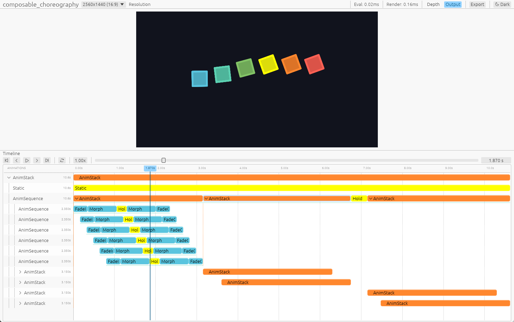

#import "../../_components/issue.notc": issue;
#import "../../_components/pele/lib.notc" as pele;
# v0.3

> **Status: Draft** — 随 main 更新，v0.3 发布时冻结。
> 已覆盖 #issue("166")–#issue("202") 中的全部特性与架构类 PR；基建/修复类（#issue("178")、#issue("179")、#issue("188")、#issue("191")、#issue("199")、#issue("203")）不入篇。

本篇是 v0.3 的 News 纪事（体裁类似 Bevy News）。编排、求值输出与渲染侧按当前实现编写：
完整 `Eval::Output` 原样进入类型化帧，独立 render SubApp 通过值级 `Extract`
和显式泛型插件消费这些输出。

## 新增

- 音频平面
  - `AudioClip`/`AudioTrack`/`Sound`：音频作为叶子与视觉动画并列编排，支持 gain、fade、trim（`with_play_secs` 接受源轴 range）；线性变速与视觉动画统一走 cell 层的 `with_duration`/`with_rate_func`（磁带式变速，音高随窗口缩放）
  - `AudioClip::from_file`/`from_bytes`（随 `audio-decode` feature）纯 Rust 解码（symphonia，WAV/MP3/FLAC/AAC/Ogg Vorbis）并经 rubato FFT 重采样归一到 48 kHz 立体声，不再依赖 ffmpeg 二进制
  - `RanimScene::seal` 时一次性 bake 成 master stereo/48 kHz buffer；线性路径预混，非线性路径走 residual forest
  - preview 原生播放（随 `cmd-preview` feature）、Web Audio 同步播放与 render 端 ffmpeg muxing（MP4/MOV AAC，WebM libopus，GIF 丢弃）
- 可组合动画编排系统（见 "Composable Animation Arrangement" 一节）
  - `AnimSequence`/`AnimStack` 容器与 `seq!`/`stack!` 宏，`hold`/`forward`/`extend` 等编排 API
  - `AnimLagged` 容器（stagger 排布 + 窗口外静态填充）与 `lagged!` 宏、迭代器容器收集（`collect::<AnimStack>()`/`collect::<AnimSequence>()`、`into_stack`/`into_seq`/`into_lagged`）
  - 播放参数 `Paramed<A>`（`with_duration`/`with_rate_func`/`with_enabled`）与放置 `At<A>`
- 求值协议与适配器（见"求值与迭代式动画区段"一节）
  - 单一 `Eval` 协议：`eval_alpha(&self, alpha)` 是叶子动画唯一的求值入口
  - 进度是唯一坐标：`Time`/`DeltaTime` 结构已删除，`ranim_core::time` 只保留 `Alpha`/`DeltaAlpha` 两个类型别名
  - 纯/迭代特化位于 *ranim-core*：`Pure` 包装闭式闭包，`Iterative` 包装 `IterativeEval` step 逻辑；闭包经 `Pure::new(|alpha| ...)` / `Iterative::from_fn(state, step_fn)` 成为动画
  - `SceneEvaluator::sample_at` 是唯一 session 交互，seek/重放由 stateful 节点内部完成
- 类型化变换系统（见"类型化变换系统"一节）
  - `Transformed<T, G>` 包装器、`ApplyTransform<G>` primitive trait 与类型化变换群（`Translation`/`Rigid`/`Similarity`/`Diag`/`DAffine3`），语义闭包约束的 `bake()`
  - 规范局部原语：语义形状移除定位字段，placement 只存在于 `Transformed`（"canonical local primitives" 教义）
  - 渲染组件 `RenderVItem` 携带局部到世界 `transform: Mat4`，渲染侧 per-item transform storage buffer，插值契约（wrapper lerp 动位姿、morph 是显式 bake）
  - 场景图层级 `hierarchy::Node` 与 glTF/GLB 导入（见"场景图层级与 glTF 导入"一节）
- VItem 法向投影：`Basis2d` 移除，`normal: Option` + shader 内现场生成正交基（见"VItem 法向投影"一节）
- 完整求值输出与值级 `Extract`：容器、异构元组、层级树与变换 wrapper 原样入帧，渲染侧递归提取；`ExtractPlugin<T>` 为实际完整类型显式注册入口
- 命令行入口：`ranim::App` 与 `ranim::Plugin` 分别是 `bevy_app::App` / `bevy_app::Plugin` 的直接再导出；场景注册/选择（`add_scene`/`add_scenes`/`scenes`/`scene(name)`/`first_scene()`）由 `ranim::app::AppExt`（prelude 已导出）在 App 上提供，`scene(name)`/`first_scene()` 返回克隆的 `Scene`。`ranim::RanimAppExt::build`（prelude 已导出）把构建中的 App 定稿为 `ranim::RanimApp`：断言插件 Ready 并执行一次 bevy 的 `finish()`/`cleanup()`；`RanimApp` 是项目的会话期形态——`Deref`/`DerefMut` 到 bevy `App`，update、渲染 SubApp 安装、资源访问与场景选择照常工作，但不再是插件构建目标，「会话入口要求插件已构建完毕」由此成为显式的类型前提。CLI 入口是自由函数 `ranim::cmd::cli::run_cli`（接收 `RanimApp`，prelude 导出为 `run_cli`，native + `cmd-render` 门控），与 `preview_scene(app.build(), scene)`、`render_scene(&scene, &setup, ...)` 同风格：安装 tracing、解析进程参数并分发 `preview` / `output` / `render` / `inspect` 子命令，出错时打印并以非零状态退出；命名避开 bevy App 自带的 `run()` runner 入口。`App::new()` + `add_scenes([...])` + `run_cli(app.build())` 即最小项目；插件 `build` 的 `&mut bevy_app::App` 与 `&mut App` 是同一类型；`inspect scenes/tree/frame` 无 GPU 检查；agent one-shot 例子已迁至独立仓库 `ranim-one-shot`（见"CLI"一节）
- 渲染与输出：`Renderer` 结构体溶解为渲染 SubApp 的安装与驱动 API——`ranim_render::build_render_app(ctx, width, height, oit_layers)` 构建裸渲染 `SubApp`，`install_render_app` 应用项目 `RenderSetup` 后以 `RanimRenderApp` 标签挂进 App 并挂 extract 钩子（每次 `App::update()` 主 schedule 结束后把主世界的 `EvaluatedFrame` 交换进渲染世界），`RenderAppExt` 为 SubApp 提供手动驱动与 GPU profiler 访问器；公共阶段改为 pub 的 `RenderSchedule::{Extract, Prepare, View}` 与 `ViewPhase::{Clear, Compute, Depth, Color, Resolve}` 枚举（`RenderSchedules` 句柄 resource 已删除）；core 中按类型批次传输的 `EvaluatedFrame` 与项目提供的 `RenderSetup`（未注册时按 `items` 是否启用，分别回退到安装 `RanimItemsPlugin` 的默认渲染配置或空配置）；渲染 worker API（`RenderWorker`/`RenderThreadHandle`/`RanimRenderApp`）公开；`Output::name_template` 输出名模板；examples 用同一个 bin target 按平台选择 native CLI 与 WASM 导出，共享装配，并经 `#[wasm_demo_doc]` 提供 rustdoc 实时预览；coplanar z-fighting 按 scene-order 深度偏置解决

## BREAKING CHANGES

- 动画组织系统
  - 弃用 `Timeline`（迁移到 `AnimSequence`/`AnimStack`）
  - 运行时节点统一为 `AnimNode { timing shell, NodeContent }`；`AnimationCell<T>` 不再存在，播放参数改为 `Paramed<A>` / `At<A>`，放置状态由 `Unplaced` 表达
  - `AnimationInfoKind` 收敛为 `Anim` / `Children` / `Audio`；检查动画树时按子片段窗口判断顺序或重叠，`inspect tree` 的 `kind` 对应为 `anim` / `children` / `audio`
  - 作者协议改名与分层：`Animation` → `IntoAnimNode`（`build()` → `into_anim_node()`），`Placeable` → `Unplaced`，`AnimationExt` → `PlaybackExt`
  - 模块路径分层：`animation::node`（运行时核心）、`animation::eval`（叶子协议与适配器）、`animation::build`（lowering / playback）、`animation::compose`（sequence/stack/lagged）、`animation::sound`（音频叶子）
  - *ranim-anims* 中全部内置动画创建工具方法现在默认用 `linear` 速率函数和 `1.0` 持续秒数
- 求值与内置动画 API
  - `Eval<T>` 泛型参数改为关联类型，方法集收敛为单一 `eval_alpha(&self, alpha)`（见"求值与迭代式动画区段"一节）；`sample`/`reset`/`step` 与 `PureEval` 已删除
  - `Time`/`DeltaTime` 结构已删除；`Eval::eval_alpha` 收 `f64`，`IterativeEval::step` 收 `alpha`/`delta_alpha`
  - 内置动画工具方法直接返回具名动画类型（如 `fade_in()` 返回 `FadeIn<T>`），这些类型直接实现 `Eval`
  - `Pure` 与 `Iterative` 从 *ranim-anims* 移入 *ranim-core* 的 `animation::eval::{pure, iterative}`
  - `CameraFrame::orbit` 移到 *ranim-anims* 的 `CameraFrameAnim`
  - 删除 *ranim-anims* 的 `Lagged` 求值器与 `lagged` 模块（`LaggedAnim` 糖），stagger 排布改用 `AnimLagged` 容器
  - 删除 core 中原有的 `Extract<Target = CoreItem>`、`AnyExtractCoreItem`、`DynItem` 与封闭的 `CoreItem` 枚举；求值保留完整输出。渲染协议改为 `ranim_render::extract::Extract::extract(&self, ctx)`，由宿主显式安装 `ExtractPlugin<实际完整输出类型>`
  - 动画叶子的 `Output` 要求 `Clone + Send + Sync + 'static`；纯 CPU 求值不要求实现渲染 trait
- 变换与物件模型（见"类型化变换系统"一节）
  - `MeshItem`/`Surface` 移除内嵌 transform 字段与 `with_transform`，外挂变换改用 `.transformed(...)`
  - `Square`/`Rectangle`/`Circle`/`Sphere`/`Arc`/`Ellipse`/`EllipticArc`/`TextItem` 等语义形状移除 `center`/`axes`/`p0`/`origin` 等定位字段：构造后用 `.transformed(Translation(...))` 放置；裸值不再实现 `ApplyTransform`，`shift`/`rotate_*`/非均匀 `scale` 需先包裹（或转为 `Polygon`/`VItem` 等点集类型）
  - 渲染组件 `RenderVItem` 的 `points`/`normal` 变为局部空间值，定位存放在新增的 `transform: Mat4`；消费提取点数据的代码需先应用 transform
  - `ranim_items::mesh::MeshItem` 用户层类型由 f32（`Vec3`/`Mat4`）改为 f64（`DVec3`/`DMat4`）
- 渲染与 CLI
  - 项目模型切换到 bevy App：`ranim::App` 与 `ranim::Plugin` 分别是 `bevy_app::App` / `bevy_app::Plugin` 的直接再导出；`SceneHandle` / `PluginError` 已删除。场景注册与选择（`add_scene` / `add_scenes` / `scene` / `first_scene` / `scenes`）由 `ranim::app::AppExt` trait（prelude 已导出）在 App 上提供，场景存于 `Scenes` resource；`app.scene(name)` / `app.first_scene()` 返回克隆的 `Scene`。插件 `build` 的 `app: &mut bevy_app::App` 与 `&mut ranim::App` 是同一类型，两种写法等价；项目资源是普通 bevy resource（类型 `#[derive(Resource)]`，`ranim::Resource` 已再导出，`insert_resource` 存入、`world()` 读取）
  - 命令行入口是自由函数 `ranim::cmd::cli::run_cli`（接收 `ranim::RanimApp`，prelude 导出为 `run_cli`，native + `cmd-render` 门控）：安装 tracing、解析进程参数并分发子命令，出错时打印并以非零状态退出；最小项目注册场景后以 `app.build()`（`ranim::RanimAppExt`，prelude 导出）定稿插件构建——断言插件 Ready，执行一次 bevy `finish()`/`cleanup()`——再调用 `run_cli(app.build())`，子命令 `preview` / `output` / `render` / `inspect` 不变。`RanimApp` `Deref`/`DerefMut` 到 bevy `App`，是 update、SubApp 安装与资源访问的会话期形态，不再是插件构建目标。命名刻意避开 bevy App 自带的 `run()`（runner 模型）。`inspect` 可查询包含延迟 setup 的项目，仍不初始化 GPU
  - `Renderer` 结构体溶解：`ranim_render::build_render_app(ctx, width, height, oit_layers)` 构建裸渲染 `SubApp`；`install_render_app(app, ctx, width, height, oit_layers, setup)` 应用项目 `RenderSetup` 后以 `RanimRenderApp` 标签挂进 App，并挂 extract 钩子（每次 `App::update()` 主 schedule 结束后把主世界的 `EvaluatedFrame` 交换进渲染世界）；`RenderAppExt` 为 `SubApp` 提供 `render_frame(textures, clear_color, frame)` 手动驱动与 GPU profiler 访问器。`RenderSchedule::{Extract, Prepare, View}` 与 `ViewPhase::{Clear, Compute, Depth, Color, Resolve}` 是 pub 的 label / set 枚举，渲染插件直接引用（`RenderSchedules` 句柄 resource 已删除）
  - `RenderSetup` 现在是 bevy `Resource` + bevy `Plugin`（`is_unique = false`）：项目可将 setup 存为 App resource，装配 `ranim_items::RanimItemsPlugin`（捆绑内置相机、矢量与网格物件插件）与未覆盖完整类型的 `ExtractPlugin<T>`；项目未注册 setup 时，启用 `items` 的宿主回退到仅含 `RanimItemsPlugin` 的默认配置，未启用时使用空配置，渲染宿主不再硬编码物件插件
  - `RenderWorker::new` / `RanimRenderApp::new` 等离线渲染 API 改为接收 `(scene: &Scene, setup: &RenderSetup, output, buffer_count)`；`render_scene*` / `render_scene_output*` 帮助函数同样接收 `&Scene` 与 `&RenderSetup`；preview 为 `preview_scene(app: RanimApp, scene)`
  - 删除 `ranim_core::core_item`：通用变换移到 `ranim_core::transformed`；相机移到 `ranim_items::camera`；render world 组件改为 items 的 `vitem::render::RenderVItem` / `mesh::render::RenderMeshItem`，对应缓冲、管线与系统同归该物件模块，通过 items 的 `render` feature 提供
  - 帧数据统一为 `ranim_core::frame::EvaluatedFrame`：替换 `ranim_render::world::RenderFrame` 与原来的 `scene_evaluator::EvaluatedFrame` Vec 别名，item ID 使用 `ranim_core::frame::FrameItemId`；`RenderAppExt::render_frame` 与 `RenderWorker::render_store` 改为接收 `&mut EvaluatedFrame`，渲染完成后返还帧数据供复用
  - `SceneEvaluator::sample_at` 直接替换 `EvaluatedFrame` 的内容；`SealedRanimScene::eval_at_sec` / `eval_at_alpha` 同样接收 `&mut EvaluatedFrame`。结果按具体类型用 `frame.items::<T>()` 读取，每项包含 `id`、`order` 与完整的 `value`
  - 自定义物件通过值级 `Extract` 递归复用现有实现，或经 `ExtractContext` 写入实体和资源；`ExtractPlugin<T>` 只匹配精确的帧类型，注册 `T` 不会自动读取 `Vec<T>` 或 `Transformed<T, G>`
  - `TextItem` / `TypstText` 保留自身类型，项目启用 `typst`；裸文字类型的提取由 `VItemPlugin` 提供（默认渲染配置已包含）
  - typed frame 按实际 `TypeId` 匹配；inspect 保留未适配输入的 opaque 元数据，提取系统只能读取匹配类型的批次，不按同名类型强转
  - `inspect frame` 的 JSON schema 升级到 `2`，完整输出的输入顺序为 `order`，新增 `input_type`；支持的裸内置类型提供 CPU 几何投影，未适配的完整类型保留为 opaque 元数据
  - `VItemsBuffer::update`/`MeshItemsBuffer::update` 的迭代项改为 `(scene_order, item)` 对
  - `render` 子命令语义变化：批量渲染所有 `#[output]` 改用 `output`；`render <scene>` 只做单场景临时渲染，忽略 `#[output]` 与 Capture mark
  - `ranim_items::vitem::Basis2d` 移除，`VItem.basis` 改为 `normal: Option<DVec3>`（构造迁移：`with_basis(Basis2d::XY)` → `with_normal(...)` 或留空自动计算）
  - `SvgItem` 内部改为放置树（`Transformed<Node<VItem>, DAffine3>`）：`tree()`/`tree_mut()`/`into_tree()` 返回放置而非裸节点（用 `.inner` 取 frame）；glTF 支持为 opt-in 的 `gltf` feature

## Composable Animation Arrangement

https://github.com/AzurIce/ranim/pull/170

### `AnimSequence` 和 `AnimStack`

Ranim 动画编排的本质是构造动画数据表示并放入集合，在之前的设计中整个 `RanimScene` 通过内部的 `Vec<Timeline>` 来维护动画。

`Timeline` 的本质是 `Vec<Box<dyn CoreItemAnimation>>` 动画序列容器，其中的每个元素都是前后相继的动画表示，同一时间一个 `Timeline` 只有一个动画激活，于是以前在动画组合代数上非常局限：
- 串行的动画必须通过 `Timeline` 的 API 手动推进/同步时间到对应位置
- 并行的动画必须通过创建新的 `Timeline` 来实现
- 整个场景的 `Vec<Timeline>` 本质是一次性并行组合多个串行编排的性质

在 Ranim v0.3 中，原本的 `Timeline` 被弃用，新增了两个可组合的基本动画容器 `AnimSequence` 和 `AnimStack`。

比如对于如下的动画：

- 正方形：0.0s ~ 1.0s 淡入 | 1.0s ~ 2.0s 变成圆形 | 2.0s ~ 3.0s 淡出
- 文字：0.5s ~ 1.5s 写入 | 1.5s ~ 2.5s 擦除

在以前的 Timeline API 下要这样编写：

```rust
let r_vitem = r.insert_with(|t| {
    t.play(item.fade_in())
        .play(item.morph_to(VItem::from(Circle::default())))
        .play(item.fade_out())
});
let r_text = r.insert_with(|t| {
    t.forward(0.5)
        .play(text.write())
        .play(text.unwrite())
});
```

而使用 `AnimSequence` 和 `AnimStack` 可以这样：

```rust
let anim = stack![
    seq![
        item.fade_in(),
        item.morph_to(VItem::from(Circle::default())),
        item.fade_out(),
    ],
    seq![
        text.write(),
        text.unwrite()
    ].at(0.5)
];
r.play(anim);
```

其中的 `seq!` 和 `stack!`（类似 `vec!`），会构造 `AnimSequence` 和 `AnimStack` 并将动画插入其中（类似 `Vec`）。

如果要把这段动画播放两遍，原来的 Timeline API 会非常繁琐，或许需要将相关时间线操作封装为闭包，而对于新的可组合 API 很简单：

```rust
r.play(seq![anim.clone(), anim]);
```

更能够表现新系统的可组合与复用能力的例子见 `composable_choreaography` example。

### `AnimNode`、`Eval` 与 `IntoAnimNode`

`Eval<T>` 的泛型参数被移除并改成了关联类型（一个求值器类型的求值结果类型是唯一的）。

所有作者定义最终都 lower 成运行时节点 `AnimNode`。`AnimNode` 的内容是封闭的 `NodeContent`，只包含运行时真正需要解释的形态：

```text
NodeContent
├─ Children(Vec<AnimNode>)
└─ Leaf(LeafContent)
   ├─ Anim(Box<dyn EvalDyn>)
   └─ Audio(Box<AudioTrack>)
```

顺序、并行与交错组合都在构造期安排时间窗口，运行时统一遍历命中的 children。
`AnimSequence::into_anim_node` 消解被覆盖的零时长片段，并排除被末尾
`show()` / `hide()` 覆盖的前一片段的右端点；嵌套 sequence 保留相同的末态。
静态保持和 lagged 的边缘填充捕获可克隆的原始输出值，内部通过 `HeldOutput`
按原类型重放；普通叶子直接将完整求值结果写入帧。

叶子通过 `Eval` 保持开放，lowering 协议则是 `IntoAnimNode`：

```rust
/// A definition that can be lowered into the runtime animation tree.
pub trait IntoAnimNode: Sized {
    /// Lower this definition into its local runtime representation.
    fn into_anim_node(self) -> AnimNode;
}
```

所有的 `E: Eval where E::Output: Clone + Send + Sync + 'static` 都自动实现 `IntoAnimNode`，因此动画创建直接返回自身即可使用，不需要手写 lowering：

```rust
impl<T: FadingRequirement + Sized + 'static> FadingAnim for T {
    fn fade_in(&mut self) -> FadeIn<Self> {
        FadeIn::new(self.clone()).apply_to(self)
    }
    fn fade_out(&mut self) -> FadeOut<Self> {
        FadeOut::new(self.clone()).apply_to(self)
    }
}
```

`IntoAnimNode` 是可组合动画的统一入口。`AnimSequence`、`AnimStack`、`AnimLagged`、`Paramed<A>` 和 `At<A>` 都实现它，因此既可以独立构造，也可以被 Scene 或其它容器接纳。

### `AnimLagged` 与迭代器收集

stagger 排布由 `AnimLagged` 容器表达：

```rust
let animation = lagged![0.2; a.fade_in(), b.fade_in(), c.write()];
```

- 子动画要求 `Unplaced`（和 `AnimSequence` 一样），放置由容器计算：`start_i = start_{i-1} + lag_ratio · d_{i-1}`。`lag_ratio` 因此是 `AnimStack`（0.0，同时）与 `AnimSequence`（1.0，相继）之间的插值；
- 窗口外时间由 `with_leading`/`with_trailing` 配置（`LaggedFill::{Hold, Empty}`，默认都 `Hold`）：每个元素在 build 时被物化为一条 `[前填充][动画][后填充]` 的 per-item `AnimSequence` 轨道（前=初态、后=末态，采样自窗口边缘；空填充跳过；零时长子项跳过前填充）——preview 时间线所见即所得，没有隐藏的钳制规则。想让元素窗口后消失，让它的动画以 `hide` 结尾（`seq![item.fade_in(), item.hide()]`）；
- 由于填充在 build 时采样，子动画应当是纯（闭式）动画；
- 子动画是完整的 `IntoAnimNode`：可以自带 `with_rate_func`/`with_duration` 等播放参数，容器在各自 node 上施加速率；
- 配套迭代器 API：`collect::<AnimStack>()`/`collect::<AnimSequence>()`（`FromIterator`）与 `AnimIterExt::{into_stack, into_seq, into_lagged}`。

窗口与填充语义一张图看懂——示意 `lagged![0.2; a, b, c]`、各动画 1 秒、默认 `Hold` 填充（时间轴单位 0.2 秒）：

#pele.diagram(r#"""
gantt
    dateFormat X
    axisFormat %s
    title lagged 容器窗口示意（lag_ratio 0.2）
    section a
    动画 :a1, 0, 5
    后填充（末态 Hold） :a2, 5, 7
    section b
    前填充（初态 Hold） :b0, 0, 1
    动画 :b1, 1, 6
    后填充（末态 Hold） :b2, 6, 7
    section c
    前填充（初态 Hold） :c0, 0, 2
    动画 :c1, 2, 7
"""#)

### `Paramed<A>`、`At<A>`

动画本身在时间轴上“长什么样子”并不依赖于其起始时间，只有在要 **放置** 在某种时间坐标上的时候起始时间才存在作用。对于 `AnimSequence` 和 `AnimStack` 来说，前者反而要求动画没有被指定起始时间，因为动画要被相继紧接着放置进序列中。

原先统一在 `AnimationInfo` 内的动画参数现在拆分到了 `Paramed<A>` 和 `At<A>` 两个泛型结构体内：

```rust
/// An animation definition with overridden playback parameters.
pub struct Paramed<A> {
    inner: A,
    param: AnimationParam,
}

/// An animation fixed at an offset in its parent's time coordinates.
///
/// This is a terminal placement entry: it implements [`IntoAnimNode`] but not
/// [`Unplaced`], so playback parameters must be configured before calling
/// [`Unplaced::at`].
pub struct At<A> {
    inner: A,
    offset_sec: f64,
}
```

使用 `.with_duration`、`with_rate_func`、`with_enabled` 会自动修改或包裹 `Paramed<A>`，使用 `.at` 会自动包裹 `At<A>`。

## Preview App 时间轴控件重构

在新的动画组织系统下，Preview App 的时间轴控件也对应做了大幅重构：



## 完整求值帧、值级 Extract 与 render SubApp

https://github.com/AzurIce/ranim/pull/175

Ranim 现在把完整动画输出保留到渲染侧。求值只产生 CPU 值，独立 render
`SubApp` 通过已注册的泛型提取系统解释这些值，再准备 GPU 数据。动画树和
用户层物件继续位于 ECS World 之外，core 不依赖 renderer。

### 完整 `Eval::Output` 保留语义

动画树的 children 负责时间映射与遍历；普通叶子调用 `eval_alpha(alpha)` 后，
直接把返回值写入类型化帧。若返回 `Vec<(Circle, Line)>`，帧中保存的就是这个
完整类型，而不是预先拆出的 `Circle` 和 `Line` 批次。`Node`、`SvgItem`、模拟
状态与 `Transformed<T, G>` 同样保留自己的结构。

求值协议因此不需要知道“哪些值最终可见”或“一个值对应几个实体”。同一个
完整输出可以由渲染侧决定细节层次、分解方式和资源表示，也可以只用于 CPU
检查。`Output` 的要求是 `Clone + Send + Sync + 'static`：`Clone` 供 `hold`
和 lagged 静态填充捕获原始值，线程安全要求用于帧传输。捕获路径内部保存
`DynOutput`，保持区间按原类型重放；连续 hold 不会把捕获列表变成新的公开帧
类型。普通采样直接写入批次，无需为每个值装箱。

### 值级 `Extract` 复用已有表示

渲染协议位于 `ranim_render::extract`，借用输入并通过 `ExtractContext` 更新
World。自定义值可以委托给内部物件的实现，也可以直接生成组件或资源：

```rust,ignore
use ranim_items::vitem::geometry::Circle;
use ranim_render::extract::{Extract, ExtractContext};

#[derive(Clone)]
struct Marker {
    radius: f64,
}

impl Extract for Marker {
    fn extract(&self, ctx: &mut ExtractContext<'_>) {
        Circle::new(self.radius).extract(ctx);
    }
}
```

这替代了原有 `Extract<Target = CoreItem>` 的提前投影。新协议没有关联输出
类型，也不要求返回一个公共图元列表。`Vec<T>`、数组、`Option<T>`、1..=15 元组
和 `Transformed<T, G>` 在 renderer 中递归调用成员的 `Extract`；items 的 `Node`
按 payload、子节点顺序递归。具体形状则转换到合适的表示，再委托其提取实现。
这些调用共享同一个上下文，组合不会多出一套容器实体或要求逻辑使用 ECS。

`ctx.entity::<Bundle>()` 以 bundle 类型领取本输入的下一个持久输出实体；同一
位置改变 bundle 类型时重建实体，避免旧形态组件残留。`ctx.world_mut()` 可
更新资源或执行自定义 World 操作，直接创建的实体需自行管理生命周期。
`ctx.transform()` 读取累计变换，`with_transform` 在 `parent * child` 下递归。
变换仍保存在原始 wrapper 中，提取时才组合到 primitive 的渲染矩阵；输入的
局部几何不会因渲染而被改写。完整 API 与使用方式见
[完整求值帧与渲染提取](../../understand/core/extract.md)。

### core 生产 `EvaluatedFrame`，render SubApp 消费

`ranim_core::frame::EvaluatedFrame` 按具体类型保存可复用批次，整个批次统一
擦除类型。`SceneEvaluator::sample_at` 直接填入缓冲，预览与导出再将它交给
renderer。`FrameItem<T>` 携带 `id`、全局 `order` 与完整的 `value`；不同类型
共享插入顺序，无须依赖批次容器的遍历顺序：

```rust,ignore
use ranim_items::camera::CameraFrame;
use ranim_core::frame::EvaluatedFrame;
use ranim_items::vitem::geometry::Circle;

let mut frame = EvaluatedFrame::new();
frame.push((0, 0), CameraFrame::default());
frame.push((1, 0), vec![Circle::new(1.0), Circle::new(2.0)]);
assert_eq!(frame.items::<CameraFrame>()[0].order, 0);
assert_eq!(frame.items::<Vec<Circle>>()[0].order, 1);
assert!(frame.items::<Circle>().is_empty());
assert_eq!(frame.len(), 2);
```

`id` 中的 `(animation_id, part)` 标识顶层动画与其完整输出序号，容器成员不在
求值阶段占用额外 ID。`clear` 保留批次容量；`update` 清空整帧后填入一个类型
的批次。输入可产生多个实体或只更新资源，`frame.len()` 因而不表示渲染输出数。

`Renderer` 结构体已溶解：渲染侧是独立 Bevy `SubApp`（`ranim_render::build_render_app`
构建，`install_render_app` 以 `RanimRenderApp` 标签挂进项目 App），承载渲染实体、
资源、变更检测与 schedule，无需把项目 App 或动画求值改成 ECS。

### 显式组合精确输入类型与 GPU 管线

`ExtractPlugin<T>` 将值级协议接到 `RenderSchedule::Extract` 阶段；它读取的精确批次
是 `frame.items::<T>()`。例如 `ExtractPlugin<Vec<Circle>>` 可以复用容器与圆的
递归实现，但只有 `ExtractPlugin<Circle>` 时不会消费该容器输入。带变换、元组
或树的输出也需注册实际完整类型，内部的递归委托无需再安装成员类型插件。

`ranim-items` 的 `CameraFramePlugin` 注册裸相机输入与 viewport 准备，
`VItemPlugin` 注册裸矢量、`Vec<VItem>`、几何、SVG 与文字类型，`MeshItemPlugin`
注册裸网格、曲面和球体；三者同时安装各自的 GPU 渲染，并由 `RanimItemsPlugin`
捆绑为一——它与单个物件插件互斥（Bevy 插件唯一，重复安装会 panic）。矢量和
网格的渲染组件分别名为 `RenderVItem`、`RenderMeshItem`，与缓冲、管线和系统
一同放在对应 items 的 `render` 模块；纯 CPU 的逻辑 `VItem` / `MeshItem` 保持
原来的职责。`ranim-core` 只保留通用变换 `transformed`，renderer 本体无需认识
具体物件类型。

物件插件覆盖裸内置输入，不枚举容器和 wrapper 组合。文字支持随项目的
`typst` feature 提供。启用 `items` 的项目未注册 `RenderSetup` 时使用默认配置（仅安装
`RanimItemsPlugin`）；需要额外输入类型时，项目插件保存一份自定义渲染装配，
场景插件仅注册场景：

```rust,ignore
use ranim::{App, Plugin};
use ranim_items::{RanimItemsPlugin, vitem::geometry::Circle};
use ranim_render::{RenderSetup, extract::ExtractPlugin};

pub struct ProjectPlugin;

impl Plugin for ProjectPlugin {
    fn build(&self, app: &mut App) {
        app.add_plugins(ScenesPlugin);
        app.insert_resource(RenderSetup::new(|render_app| {
            render_app.add_plugins((
                RanimItemsPlugin,
                ExtractPlugin::<Vec<Circle>>::default(),
                ExtractPlugin::<Marker>::default(),
            ));
        }));
    }
}
```

`RenderSetup` 保存可重复调用的配置，存储时不创建 GPU；它同时是 bevy
`Resource` 和 `is_unique = false` 的普通 bevy plugin。output 与
preview 从项目 App 读取 setup（缺省时回退到默认配置），经
`ranim_render::install_render_app` 应用后挂为渲染 SubApp。
每个 GPU runtime 使用独立的 SubApp，分辨率重建、多个输出和后台导出都重放同一
项目的配置。低层宿主也可以用 `build_render_app` 自行构建裸渲染 SubApp，不必
经过项目层。

纯 CPU 的场景查询、求值和 `inspect` 不执行 GPU 装配。

渲染插件使用已经初始化的 GPU context，同步达到 ready 后，`finish` 与
`cleanup` 各执行一次，再开始逐帧渲染。

### 持久输出、变更检测与展开顺序

`RenderAppExt::render_frame`（`SubApp` 的扩展 trait）临时将整帧 Resource 与
渲染 SubApp 中的缓冲交换，运行一次 `SubApp::update()` 后再交换回来，输入数据与
批次容量保持完整。入口因此接收 `&mut EvaluatedFrame`，提取只借用帧中的原始值：

```rust,ignore
render_app.render_frame(&mut textures, clear_color, &mut frame);
```

泛型提取系统按完整输入类型维护私有身份映射。输入 ID 与递归提取的输出位置
共同定位实体，同类型、同 ID、同输出位置复用实体。内置 primitive 的值相同
则跳过组件写入，保留 `Changed<T>` 增量语义；自定义组件是否需要写入由其
`Extract` 实现决定。输入消失或输出数量变少时，未被 `ctx.entity::<Bundle>()` 领取的
实体自动删除。不同来源类型的映射彼此独立，不会因生成相同 primitive 而
互相清理。

身份与顺序分开维护。上下文为实体写入
`SourceOrder { order: frame_item.order, part: output_part }`；renderer 在提取
完成后统一排序成连续的 `SceneOrder`，再准备 GPU 数据。一个文字、SVG 或
容器输入产生的多个输出因而仍排在相邻输入之间，深度偏置范围依据最终渲染
rank，不把输入数量当作渲染实体数量。

### Schedule 组织渲染阶段

```text
render update: First → extract → resolve SceneOrder → prepare → render graph
  ├─ extract: 按类型批次更新渲染 World
  ├─ prepare: item GPU 数据准备、上传与绑定组更新
  └─ render graph: Begin → Render → Submit → Finish
       └─ view: clear → compute → depth → color → resolve
```

- 内部 render update 是 SubApp 的根 schedule，所有阶段完成后由
  `SubApp::update()` 清理本帧变更追踪。公共阶段是 pub 的
  `RenderSchedule::{Extract, Prepare, View}` label 与
  `ViewPhase::{Clear, Compute, Depth, Color, Resolve}` set，插件直接引用这些
  枚举值注册系统；
- `prepare` 从组件准备 GPU 输入，显式按 `SceneOrder` 排序，ECS query
  顺序不构成绘制顺序；
- render graph 驱动画面生命周期：创建 encoder、运行 view 子 schedule、提交
  command buffer、结束 profiling frame；
- `ViewPhase` 的五个公共 phase 已按序 `chain`，保证所有 depth pass 先于 color
  pass；各物件插件自行注册对应 phase，不规定 VItem 与 Mesh 管线之间的先后顺序；
- 渲染插件统一引用这些 pub 枚举值，保证各插件注册的系统参与相同调度；
  插件内部的 label / set 仍可自行定义；
- 自制的 `Graph<NodeKey, Box<dyn RenderNode>>` 节点图被移除，依赖关系与执行
  生命周期交由 Bevy schedule 管理。

## 求值与迭代式动画区段

相关 PR：#issue("177")（有状态区段引入）、#issue("183")（统一协议与容器重组）、#issue("186")（纯 eval_alpha 收敛）。本节按当前 content-is-sequence 收敛后的实现编写。

v0.2 的动画区段都是**函数式**的：从归一化进度闭式采样。这类区段无法表达**有状态的迭代式动画**（粒子、弹簧、物理模拟、三体），因为求值器无法保留跨帧状态、也无法按 `dt` 推进。v0.3 用一套通用求值协议统一两类区段，并最终把协议收敛为对进度的纯查询。

### 单一 `Eval` 协议

纯（闭式）与迭代（有状态）区段底层是同一个协议。动画内容一旦定义就不可变，evaluator 只回答一个问题：在自身归一化进度 `alpha ∈ [0, 1]` 处的输出是什么。

```rust
pub trait Eval {
    type Output;

    /// 在归一化进度 alpha 处求值。
    fn eval_alpha(&self, alpha: f64) -> Self::Output;
}
```

- `eval_alpha` 是 `&self` 上的纯查询：同一个 `alpha` 永远得到同一个 `Output`，与调用顺序和次数无关；
- evaluator 看不到秒、场景时钟或 `logic_fps`；`AnimNode` 负责把场景时间映射成 `alpha` 后再调用它；
- 有状态区段在内部记忆化自己的积分快照；纯区段就是闭式函数。

`EvalExt::apply_to` / `apply_alpha_to` 是 build 期便捷方法：它们通过 `eval_alpha` 把 item 写成指定进度（默认末态）并返回动画本身。内置动画的工具方法（`fade_in()` 等）正是靠 `apply_to` 在创建动画的同时把 item 置为末态。

### 纯闭包：`Pure`

闭包是匿名类型，不能按名字实现 `Eval`，所以用 `ranim_core::animation::eval::pure::Pure` 包一层：

```rust
pub struct Pure<F>(pub F);

impl<T, F> Eval for Pure<F>
where
    F: Fn(f64) -> T,
{
    type Output = T;

    fn eval_alpha(&self, alpha: f64) -> T {
        (self.0)(alpha)
    }
}
```

```rust
let animation = Pure::new(|alpha| Square::new(alpha)).with_duration(2.0);
```

具名纯动画（`FadeIn`、`Morph`、`Create` 等）直接实现 `Eval`，不需要这个 wrapper。

### 迭代区段：`IterativeEval` + `Iterative`

```rust
pub trait IterativeEval {
    type Output;

    /// 推进一个内容步。alpha 是当前进度，delta_alpha = 1/N。
    fn step(&self, output: &mut Self::Output, alpha: f64, delta_alpha: f64);
}
```

`Iterative::new(initial, evaluator)` 持有不可变的定义（初始状态、`sim_step`、step 逻辑），把积分快照放在内部 `RefCell<Snapshot>` 中。`with_steps(N)` 声明内容自己的步数（默认 `1/120`）；`eval_alpha(target)` 前进时逐 `sim_step` 积分，回退时从初始状态重置重放，重复查询同一个 `alpha` 是 O(1)。

迭代逻辑本身简单时，直接用 `Iterative::from_fn` 写闭包即可；逻辑时长使用**过程中的局部变量**捕获，并传给 `with_duration`，不要使用全局 `const`：

```rust
let sim_secs = 4.0;

let animation = Iterative::from_fn(
    SpringState { x: 1.0, v: 0.0 },
    move |state, _alpha, delta_alpha| {
        let dt = sim_secs * delta_alpha; // 内容自己的物理秒
        let acc = -K * state.x - C * state.v;
        state.v += acc * dt;
        state.x += state.v * dt;
    },
)
.with_steps(240)
.with_duration(sim_secs);
```

- 闭包的状态类型位于 `Fn` 输入位置，stable Rust 无法从闭包类型反推出关联 `Output`，所以 `Iterative::from_fn` 通过 `IterativeFn<S, F>` 显式绑定二者；
- 迭代逻辑较复杂、需要多个字段或复用方法时，实现命名 `IterativeEval` 结构体，并把 `sim_secs` 等参数放在 `self` 上；
- 可变状态全部住在 `Output` 里，适配器持有初始状态值，恢复是结构性的；
- 状态与可见内容不同时，可以让完整状态进入帧，再为它实现值级 `Extract`，
  在渲染侧生成几何。例如 `nbody` 的 bodies+trails 可以复用矢量物件的提取；
  宿主需为该状态的实际类型显式注册 `ExtractPlugin<T>`。

### 进度是唯一坐标

`Time` / `DeltaTime` / `GlobalTime` 已从协议中删除。`ranim_core::time` 只保留两个类型别名：

```rust
pub type Alpha = f64;       // 归一化进度
pub type DeltaAlpha = f64;  // 均匀进度步长
```

- **动画逻辑只见进度、不见时间配置**：起点、时长、rate 都属于 `AnimNode`，由它把场景时间映射成 `alpha`；
- “内容即序列”：迭代动画的内容是作者声明的进度点序列 `x₀…x_N`，`N` 是定义而不是采样精度；
- `with_duration` / `with_rate_func` / placement 是纯播放重映射（哪个进度何时可见），不改变内容本身；
- 需要真实时间的现象（如 cloth 中球的运动）使用内容自己的逻辑时长换算：`sec = sim_secs * alpha`，而不是读全局时钟。

### `SceneEvaluator`：单入口会话驱动

```rust,ignore
use ranim_core::frame::EvaluatedFrame;
use ranim_items::vitem::VItem;

let mut frame = EvaluatedFrame::new();
evaluator.sample_at(render_secs, &mut frame);
let items = frame.items::<VItem>(); // 读取该具体类型的批次
```

- `sample_at` 是唯一的 session 交互：渲染、preview 拖拽共用这条路径；
- 每次采样替换整帧内容，普通叶子将完整 `eval_alpha(...)` 结果写入实际类型的
  批次，容器和 wrapper 不提前展开；frame 保留批次容量供下次复用；
- 前进 / 回退 / 原地求值由 `Iterative` 等 stateful 节点内部完成，session 不再维护逻辑网格；
- `logic_fps` 参数仅为 API 兼容保留，不再驱动步进；步进尺度由每个迭代区段自己的 `sim_step` 决定。

### 模块布局

```text
ranim_core::animation
├── eval
│   ├── pure       （Pure）
│   └── iterative  （IterativeEval / Iterative / IterativeFn）
├── sequence       （AnimSequence）
├── stack          （AnimStack）
└── lagged         （AnimLagged）

ranim::anims
├── camera         （Orbit、CameraFrameAnim）
├── creation       （Create/UnCreate/Write/Unwrite）
├── fading         （FadeIn/FadeOut）
├── morph          （Morph）
└── rotating       （RotatingAnimation）
```

### 示例

- `iterative_spring`：阻尼弹簧，简单闭包步进，`sim_secs` 为过程局部变量；
- `nbody`：N 体引力模拟（velocity Verlet、混沌弹射终场、无边界），同样是局部 `sim_secs` + 闭包；
- `cloth_wrap`：零重力布料（弹簧力 + 自碰撞 + 球-布碰撞，MeshItem 曲面渲染；球的 kinematic 状态由 `sim_secs * alpha` 驱动，值级 `Extract` 生成几何）。

## VItem 法向投影：带宽优先于 ALU

https://github.com/AzurIce/ranim/pull/166

`Basis2d` 投影抽象被移除，VItem 的投影平面改由单个法向量表达：

- *ranim-items* 的 `VItem` 字段 `basis: Basis2d` 改为 `normal: Option<DVec3>`（渲染组件 `RenderVItem` 同样持有 `normal: Option<Vec3>`）。不显式设置时由前三点自动计算（`vitem_normal_from_points`，共线时回退 `Z` 轴），`RotateTransform` 随点数据一同旋转法向；
- 渲染侧 per-instance 的 `PlaneData` 从 3 个 vec4（origin + basis_u + basis_v）缩减为 2 个（normal + origin），u/v 基由 shader 内的 `basis_from_normal()` 现场生成：任选一根与法向足够不平行的轴，两次叉乘得到确定性正交基，compute 与 vertex 阶段复用同一 WGSL 函数保证 bit-exact。

设计原则是**带宽贵于 ALU**：每 item 的 per-instance 数据少 16 字节（-33%），代价只是几次 cross/normalize——vertex 阶段每 item 仅 4 个顶点，compute 阶段完全并行且本就 ALU-bound。确需固定投影面的场景仍可显式 `with_normal` 覆盖。

> 注：本节落地时 points 尚为世界坐标；"类型化变换系统"一节中 #issue("198") 进一步把提取语义调整为局部坐标 + `transform` 矩阵。

## 结构容器与异构元组的值级提取

https://github.com/AzurIce/ranim/pull/185

容器和异构元组现在可以直接成为完整动画输出。求值帧保留它们的原始结构，
渲染侧的递归 `Extract` 再处理各成员，成员无需共享一种输出 primitive：

```rust,ignore
use ranim_core::frame::EvaluatedFrame;
use ranim_items::vitem::geometry::{Circle, Line};
use ranim_render::extract::ExtractPlugin;

type Input = (Circle, Vec<Line>);
let mut frame = EvaluatedFrame::new();
frame.push((0, 0), (circle, vec![line]));
assert_eq!(frame.items::<Input>().len(), 1);
assert!(frame.items::<Circle>().is_empty());

// 把这个精确类型的插件加入项目 RenderSetup 的插件组合。
let plugin = ExtractPlugin::<Input>::default();
```

当前递归实现覆盖 `Vec<T>`、数组、`Option<T>`、1..=15 元组、单位类型和变换
wrapper。items 的 `Node` 也通过同一值级接口递归。它们共享上下文的输出序号
与累计变换，可以直接组合出多层嵌套，而不引入统一的返回列表。

插件注册与递归能力是两个边界：`ExtractPlugin<Input>` 注册完整帧类型，容器
实现负责其内部遍历。单独注册 `Circle` 或 `Line` 并不会读取 `Input` 批次；
内部委托 `.extract(ctx)` 则不要求再注册成员插件。这样实际输出类型与 renderer
能力由宿主明确列出，纯 CPU 求值仍可以保存任何满足传输约束的输出。

## 渲染与输出体系

相关 PR：#issue("181")（worker API）、#issue("182")（输出名模板）、#issue("187")（wasm bundle）、#issue("201")（深度偏置）

### 渲染 worker API 公开

`RenderWorker`、`RenderThreadHandle` 与 `RanimRenderApp` 及其核心方法公开，用户可以绕过高层 `render_scene*` 帮助函数自建渲染管线：`RenderWorker::{new, yeet, render_store, capture_frame, ...}`、`RenderThreadHandle::{sync_and_submit, get_store, retrive}`、`RanimRenderApp::{render_scene_with_progress, render_capture_marks}`。构造与帮助函数的签名统一为 `(scene: &Scene, setup: &RenderSetup, output, buffer_count)`——场景描述符与渲染装配显式传入，不再需要持有项目 App 的句柄。

### 输出名模板

`Output`/`StaticOutput` 新增 `name_template`，支持 `{name}`/`{width}`/`{height}`/`{fps}` 占位符，默认 `{name}_{width}x{height}_{fps}`，扩展名按输出格式自动追加；`#[output(...)]` 宏接受 `name_template = "..."` 属性（类似 Premiere/达芬奇的导出名模板）。

```rust
#[scene]
#[output(name_template = "{name}_{width}x{height}_{fps}")]
fn my_scene(r: &mut RanimScene) { /* ... */ }
```

### 按模块与命令划分 feature

默认依赖 `ranim` 即可使用内置物件、动画、渲染与原生预览：
`default = ["anims", "items", "cmd-preview"]`。命令能力依赖链是
`cmd-preview → cmd-render → render`：预览窗口包含导出面板，`cmd-render`
提供 CLI、离线导出及 ffmpeg 支持；纯 `render` 提供 GPU 渲染 API 与 WASM
canvas 宿主。`cmd-preview` 只需要 rodio 的 PCM 播放能力，音频文件解码仍由
独立的 `audio-decode` 控制。

`anims`、`items` 同时控制 optional dependency 和 re-export，`anims` 启用所需的
`items`。纯渲染通过 `ranim-items?/render` 接入物件：仅在 items 已开启时编译
内置物件的提取插件，因此自定义渲染项目可以完全不依赖内置物件。
默认宿主装配也遵循这条边界：开启 items 时安装 `RanimItemsPlugin`，否则为空；
显式注册的 `RenderSetup` 在两种配置中都保持有效。无 items 的 `inspect frame`
仍保留每项的类型、身份、来源与顺序，只省略内置物件的几何投影。

旧 `preview` feature 已移除，原生预览调用方迁移到 `cmd-preview`；
旧 `render` 中的原生命令与导出能力迁移到 `cmd-render`，纯渲染代码继续用
`render`。离线导出可用 `--no-default-features --features anims,cmd-render`，
WASM 内置示例用 `--no-default-features --features anims,render`。同一个 example 的
`required-features` 声明共享能力，xtask 按它们分组构建并关闭 default，原生导出另加 `cmd-render`。
日常预览直接运行 `cargo run --example arc -- preview`。

### examples 单 target 与 rustdoc 实时预览

每个支持浏览器预览的 example 只声明一个 bin target。`main.rs` 声明 `mod scenes`，
按 target 编译原生 CLI 或 WASM 的空 `main()` 与 `app()` 导出，
共用 `scenes.rs` 中的场景、插件和 `RenderSetup`。wasm-bindgen 将空 main 接入模块
初始化，返回后模块继续接受 JS 调用；应用装配、GPU 初始化与播放仍由 JS 显式驱动。
原生入口把
定稿后的 `RanimApp` 交给 `run_cli`；WASM 入口导出 `app() -> WasmApp`，由
JavaScript 调用 `await project.createPreview(canvas, name)` 选择已注册场景。
WASM 直接向 canvas 呈现，Web 端通过 `renderAt(seconds)` 驱动画面；
native 继续使用 egui 预览。自定义物件的精确输出类型
在共享装配中注册，因此网站预览使用与独立原生 example 相同的渲染配置。

`ranim-examples` 通过 `#[path]` 引用各个 `scenes.rs` 来生成 rustdoc。
场景可标注 `#[wasm_demo_doc]`：`#[scene]` 在公开函数文档中注入
`<ranim-viewport>` 与 `<ranim-controls>`，根据所属 example 加载其独立的 WASM
模块，按注册名创建会话。视口负责渲染和播放时钟，控制条通过 `for` 属性或
JavaScript 的 `target` 引用绑定视口；控制条可放在任意位置，也可让多个
控制条操作同一视口。视口卸载时释放 GPU 和音频资源；控制条的移动、卸载或重新绑定
只改变 UI 连接，渲染会话继续由视口持有。网站与 rustdoc 都显式组合这两个
组件。`#[scene(name = "hanoi")]` 等自定义注册名同样可用。
控制条还可向下展开为动画 timeline：顺序片段共用轨道，重叠子动画可折叠为
多行，并提供时间刻度、播放指针、片段选择和缩放。片段点击只更新详情，
上方时间刻度负责定位。动画元数据来自核心层的
同一棵树，在视口初始化时跨 WASM 读取一次；各控制条独立保存展开和缩放状态，
同时继续共享视口的播放时钟。
有声音的场景通过 `WasmPreview.audio()` 把 seal 时已混合的 PCM 复制到
JavaScript 自有声道数组，由 Web Audio 播放。画面跟随音频输出位置，暂停时同时
停止音源并固定播放位置；播放中定位会从新位置重启音源，暂停中定位保持安静。
音频缓冲每个场景只读取一次，定位和重播都复用它，无声音场景继续使用墙钟。
控制条的扬声器按钮可调节音量和静音，增益平滑变化且不重启音源；多个控制条
共享视口的音量设置，切换场景后保留。
点击播放时才打开音频设备，切换场景或卸载视口会关闭它。试试 `midi_visualizer`
的 Web App 预览，拖动进度条或展开后的 timeline 可同时定位画面和声音。
`cargo examples build [EXAMPLES...]` 把选定的同名 example 编译为 WASM bin，并分别生成
wasm-bindgen 绑定、运行 wasm-opt；`just doc-examples` 复用同一构建流程。

### coplanar z-fighting 按 scene-order 深度偏置

共面曲面的遮挡结果改由场景插入顺序决定，而非光栅化舍入：`VItemsBuffer::update`/`MeshItemsBuffer::update` 的迭代项改为 `(scene_order, item)` 对，渲染器按全局 scene order 施加每序深度偏置；新增 `z_fighting` example 展示按插入顺序的稳定遮挡。

## CLI：inspect、output/render 拆分与 agent 工作流

相关 PR：#issue("190")、#issue("192")

### 出发点：让 agent 自主完成"写场景 → 自查 → 出片"

v0.3 后期 ranim 的一个明确用户是 **coding agent**：它没有稳定的桌面环境，用不了交互式预览，却要独立走完"写场景代码 → 验证结构与时序 → 渲染出图 → 视觉检查 → 修改"的完整闭环。命令行的演进由这个初衷牵引，落在两条设计原则上。

每个项目二进制自带 `preview` / `output` / `render` / `inspect` 子命令，无需安装额外工具；本仓库中的示例以 `cargo run --example <name> -- <command>` 调用。项目架在 bevy App 上：`ranim::App` 与 `ranim::Plugin` 分别是 `bevy_app::App` / `bevy_app::Plugin` 的直接再导出，场景注册与选择由 `ranim::app::AppExt`（prelude 已导出）提供；最小项目只需创建 App、`add_scenes([...])` 注册场景、`app.build()`（`RanimAppExt`，prelude 已导出）定稿插件构建，再把得到的 `RanimApp` 交给自由函数 `run_cli`——它安装 tracing 并解析进程参数；启用 `items` 且未注册 `RenderSetup` 的项目使用默认渲染配置（内置相机与矢量/网格物件渲染，即 `ranim_items::RanimItemsPlugin`），无需装配样板。

**验证分层，贵的留到最后。** `inspect` 的三个子命令全部纯 CPU、不创建 GPU context、支持 `--format json`（顶层带 `schema_version`，供脚本解析）：

- `inspect scenes`：不调用场景构造函数，只列出 App 中注册的场景与 `#[output]` 摘要——开工第一步确认场景注册成功、输出配置无误；
- `inspect tree`：构建场景并输出层级动画树，每个节点含 `kind`（anim/children/audio）、`anim_name`、父局部坐标下的 `range`、`content_duration_secs`、`rate_func`、`enabled`，迭代节点额外报告自己的 `sim_step`——时序与组织是否正确，无需渲染即可确认；
- `inspect frame <scene> --at <sec>`：直接采样类型化帧，JSON `schema_version` 为
  `2`，报告每个完整输入的 `order`、`input_type`、身份与来源；支持的裸内置类型
  附带矢量/网格/相机或分组的 CPU 投影数据，未适配的完整类型保留 opaque 元数据。
  `--verbose` 提供完整几何，迭代动画遵循自身内容步长，无需 GPU 或渲染插件。

**快速冒烟与正式交付分离。** 渲染命令一分为二：`output [scenes...]` 批量渲染每个声明的 `#[output]`、处理 `TimeMark::Capture` 截图，是交付前的最终验证；`render <scene>` 用固定默认设置（1080p60 mp4）把单个场景快速渲一次，忽略 `#[output]` 与 Capture——迭代中只想看效果时用。内部由 `RenderJob` 抽象统一两条路径。

其中 `inspect` / `render` / `output` 完全无头，可以在没有桌面环境的会话中运行；`preview` 子命令提供交互调试：

```text
inspect scenes → inspect tree → inspect frame → render（冒烟出图）→ 视觉检查 → 修改 → output（交付）
```

原则与[命令行入口](../../cli.md)一章的表述一致：能用便宜的 `inspect` 查清的问题，不要留到昂贵的 GPU 渲染之后才发现。

### 其他

- 用户层 `MeshItem` 统一为 f64（`DVec3`/`DMat4`），与 `Surface`/`VItem` 一致；渲染侧核心表示仍为 f32，`From` 转换自动完成。

## 类型化变换系统

相关 PR：#issue("196")（包装器与变换群）、#issue("197")（规范局部原语）、#issue("198")（贯穿核心与渲染）、#issue("200")（Partial/Empty 转发）

### 动机：从散落的变换行为到统一模型

此前变换行为散落在各具体类型上：`MeshItem`/`Surface` 各自内嵌 `DMat4` transform，VItem 靠直接改点数据，`shift`/`rotate`/`scale` 分散在各自独立的 trait 里；"改语义参数"与"改渲染几何"在类型层面没有区分——同一个用户操作，在这个物件上是改矩阵、在那个物件上是改几何。v0.3 用一套模型统一：物件要么通过 `ApplyTransform<G>` **吸收**变换（当且仅当其表示对该变换族封闭），要么把变换**外挂**在新包装器 `Transformed<T, G>` 里。

### `Transformed<T, G>` 与类型化变换群

```rust
pub struct Transformed<T, G> {
    pub inner: T,
    pub transform: G,
}

pub trait TransformGroup: Sized {
    fn identity() -> Self;
    fn compose(&self, inner: &Self) -> Self; // outer * inner（列向量约定）
}

pub trait ApplyTransform<G> {
    fn apply(&mut self, transform: G) -> &mut Self;
}
```

- 变换群类型：`Translation`、`Rigid`、`Similarity`、`Diag`，到一般仿射边界 `DAffine3`；同族内组合，**跨族不隐式加宽**——需要更一般的表示时显式升级（`Translation` → `Rigid` → `Similarity` → `DAffine3`，`Diag` → `DAffine3`），让加宽点在源码里可见（阶梯图解见[理解 Ranim · Transformed](../../understand/core/transformed.md)，此处不赘）；
- 外内组合显式命名：`.transformed(inner).compose_outer(outer)` 与 `.transformed(outer).compose_inner(inner)` 都得到 `outer * inner`；wrapper 自己的 `ApplyTransform` 实现做外乘，嵌套 wrapper 从内向外扁平化；
- 便捷操作连接到 primitive action：`shift` 要求 `ApplyTransform<Translation>`、`rotate_on_axis` 要求 `Rigid`、非均匀 `scale` 要求 `Diag`、等比缩放要求 `Similarity`、AABB 系操作走既有 `ScaleTransform`/`Aabb`——每个物件只暴露保持其表示的操作；
- 模型变换止步于仿射：一般 projective `Mat4` 带非仿射齐次行、需要透视除法，属于相机投影而非模型变换；
- `Transformed::map_inner`/`map_transform` 支持重映射被包裹物与显式升级/受检降级变换存储（#issue("197")）。

### 语义闭包与 bake

`bake()` 只在 `T: ApplyTransform<G>` 精确成立时可用——语义边界由类型表达：

| 包装器 | bake | 理由 |
|---|---|---|
| `Transformed<Circle, Similarity>` | ✓ | 圆在 similarity 下仍是圆 |
| `Transformed<Circle, DAffine3>` | ✗ | 一般仿射会把圆变成椭圆 |
| `Transformed<VItem, DAffine3>` | ✓ | 点集数据吸收任意仿射 |

语义形状（圆/球/矩形/方块）只在 similarity 下实现吸收，点数据/VItem/一般网格数据吸收到 affine。想要"只是看起来变"的结果，留在 `Transformed<T, DAffine3>` 里，而不是错误地烘进语义类型。`Rectangle::scale_axes`（#issue("196") 由 `scale_local` 更名）是对固有尺寸的编辑，与外部变换组合是两件事。

### 规范局部原语：placement lives in `Transformed` only

#issue("197") 把语义形状收敛为**以原点为中心的规范局部原语**：`Square`/`Rectangle` 移除 `center`/`axes`/`p0`，`Sphere` 移除 `center`，`Arc`/`Circle`/`Ellipse`/`EllipticArc` 移除定位轴，`TextItem` 以内在 `em_size` 取代 `origin`/`basis`——净删约 1000 行 per-type 锚点/缩放管线。定位不再存在于物件上：

```rust
// 以前：Circle::new(2.0).with_center(pos)
let circle = Circle::new(2.0).transformed(Translation(pos));
```

裸的规范形状不再实现 `ApplyTransform`（`shift`/`rotate_*`/非均匀 `scale` 不可用）：要么先包裹（`.transformed(DAffine3::IDENTITY)` 恢复完整 fluent 面），要么转成点集类型（`Polygon`/`VItem`，它们仍直接吸收仿射）。锚点（core 的 `Centroid`，几何原语的 `Origin`/`Focus`）在 inner 局部空间定位后再经外层变换；example 用法收窄到实际运动群（`Translation` 轨道、`Rigid` 的魔方转动与四面体旋转经群操作组合而非手写齐次矩阵积）。

### 变换贯穿核心与渲染管线

渲染组件 `RenderVItem` 携带局部到世界 `transform: Mat4`。完整 `Transformed` 保留在求值
帧中，渲染侧的值级 `Extract` 通过上下文累计外层变换，再将它左乘 primitive
自身的矩阵，局部点数据保持不变。渲染侧 per-item transform 进只读 storage buffer，vitem vertex stage 在从平面基重建 3D 位置后应用 `transforms[instance]`。由此确立**插值契约**：wrapper 的 lerp 只动位姿、inner 几何恒定；经典 morph 是显式的 bake 进裸 `VItem`/`MeshItem`。提取出的核心 `VItem::points` 与可选 `normal` 由此变为局部空间值——消费方需先应用 transform；`inspect` 的已知类型投影同样遵循这一约定。

#pele.diagram(r#"""
flowchart LR
    U["用户空间<br/>Transformed&lt;T, G&gt;<br/>位姿在 wrapper，inner 恒定"] -->|"完整 Eval::Output"| F["typed EvaluatedFrame"]
    F -->|"值级 Extract：组合矩阵"| K["RenderVItem<br/>points/normal 局部坐标<br/>+ transform: Mat4"]
    K -->|"update：只读 storage buffer"| G["渲染侧<br/>per-item transforms"]
    G --> V["vertex stage：<br/>平面基重建后按实例应用 transform"]
"""#)

### 法向量的仿射变换

对线性部分为 $A$ 的仿射变换，显式法向按 $bold(n)' = A^(-T) bold(n)$（逆转置）变换而非按点/向量变换，mesh shader 相应使用 cofactor 形式——非均匀缩放与剪切下法向仍垂直于表面。

配套的小步：#issue("200") 为 wrapper 补齐 `Partial`/`Empty` 转发（此前已转发 `Interpolatable`/`Opacity` 与填/描色），被包裹的物件由此可直接 `create()`/`write()`——`get_partial` 取 inner 的部分切片并原样保留克隆的位姿，`empty()` 组合 `T::empty()` 与 `G::identity()`。

## 场景图层级与 glTF 导入

https://github.com/AzurIce/ranim/pull/202

"placement lives in `Transformed` only" 的教义推广到树上：

```rust
pub struct Node<I, G = DAffine3> {
    pub id: Option<String>,
    pub item: Option<I>,
    pub children: Vec<Transformed<Node<I, G>, G>>,
}
```

#pele.diagram(r#"""
flowchart TB
    R["Node：根 frame（id）"] -->|pose| C1["Node：&lt;g&gt; frame"]
    R -->|pose| L1["Node：path 叶子"]
    C1 -->|pose| L2["path 叶子（id: stripes）"]
    C1 -->|pose| L3["path 叶子"]
"""#)

位姿住在边上——图中每条 `pose` 边都是一个 `Transformed` 包裹：

- `Node` 是纯结构（id + 可选 payload + 子节点），每个子节点的位姿住在边上的 `Transformed` 里；全部递归代数——渲染提取、lerp、align、partial/empty、AABB、centroid、样式转发、按 id 寻址（`by_id`/`by_ids`/`by_id_path`）——由 `Transformed` 自身的实现组合而来，`Node` 不再依赖 `TransformGroup`；
- 对齐遵循统一规则：**缺席侧用对侧的透明克隆填充**（payload 缺席、空/非空子列表同理），跨结构 lerp 平滑淡入淡出；`leaf()`/`group()`/`branch()` 构造器保持调用点简短，裸节点与包裹节点可在同一 `vec![...]` 里混排（裸节点按 identity 位姿放置）；
- `SvgItem` 重建在该树上：`<g>` 映射为纯 frame、`<path>` 为 payload 叶子，元素 id 全程可寻址——`svg.by_id("stripes")?.set_fill_color(BLACK)`；`SvgItem::new` 把居中 + Y 翻转**组合**到根放置上（而非替换根变换），viewBox 缩放得以保留；提取插件按深度优先保持 painter's-algorithm 顺序，`From<SvgItem> for Vec<VItem>` 保留旧的 bake 工作流（`TextItem` 依赖于此）；
- glTF/GLB 导入（新 `gltf` feature，opt-in）：`node_tree_from_path`/`node_tree_from_gltf` 返回 `GltfTree`（节点树 + 文档索引→路径映射），名字（`by_id`）与文档索引（`node`，动画 channel 与 `skin.joints` 的寻址方式）双寻址；glTF 强制的 Y-up 自动转为 ranim 的 Z-up（翻转组合进场景根放置）；单 primitive mesh 直接作 payload，多 primitive 拆为兄弟叶子。首版不含 materials/skins/morph targets/动画/`data:` buffer；
- 整树 posing 只组合根矩阵，不重写所有控制点。#issue("202") 中 Ghostscript Tiger
  （138 paths）的 posing 对照记录如下；当前求值帧传输与 render extract 已分开，
  该记录不作为完整新管线的性能测量：

  | 操作（整树） | 旧（baked） | 新（树上） |
  |---|---|---|
  | pose：rotate | 4.57 µs | 18.9 ns（~250×） |
  | pose：shift | 4.52 µs | 9.5 ns（~500×） |
