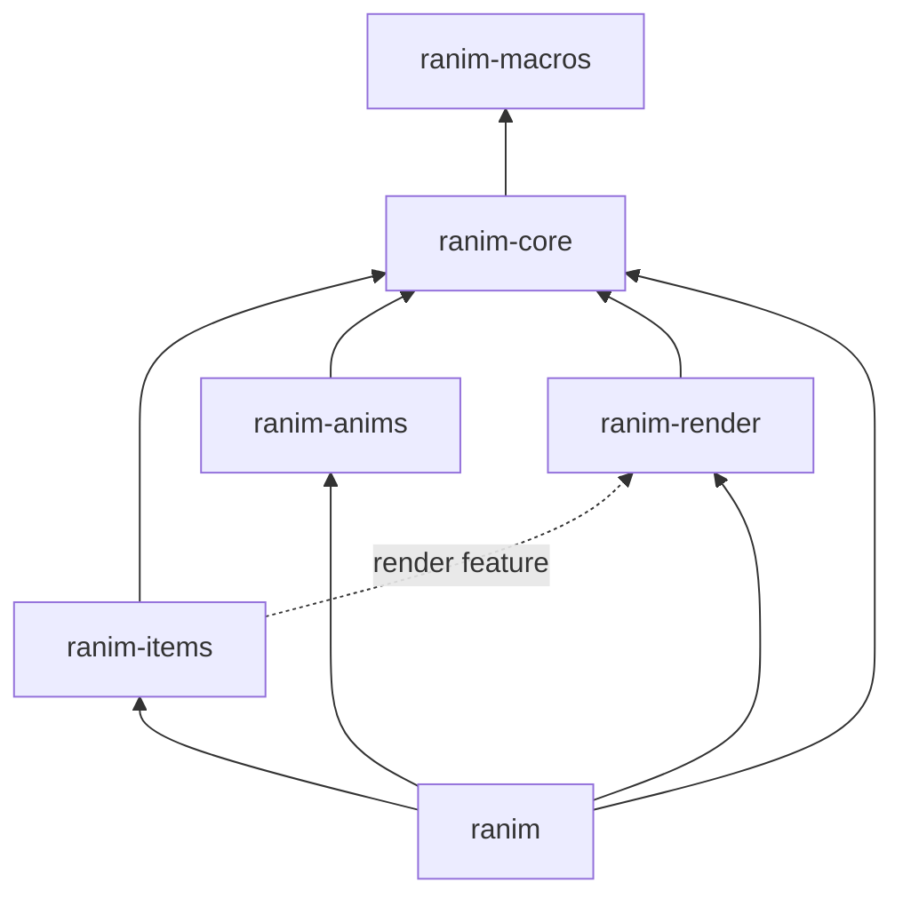

# Packages

```text
.
├── src/                        # ranim - 顶层 facade crate（含 App/Plugin 项目装配与命令行入口）
├── packages/
│   ├── ranim-core/             # 核心动画引擎（求值、组合、通用变换与动画 trait）
│   ├── ranim-macros/           # proc-macro（#[scene]、#[output] 等）
│   ├── ranim-items/            # 内置物件、相机与可选的物件渲染插件
│   ├── ranim-anims/            # 内置动画（淡入淡出、变形、书写等）
│   ├── ranim-render/           # 通用渲染宿主与调度（wgpu / Bevy SubApp）
│   └── ranim-examples/         # rustdoc 聚合库，库入口在 examples/ 中
├── examples/                  # 各例子的 native / WASM 双入口与共享场景
├── example-packages/app/       # 示例应用
├── benches/                    # 性能基准测试
└── xtasks/xtask-examples/      # 示例构建自动化
```



顶层 `ranim` 是 facade crate：`ranim::app` 模块是不依赖 GPU 的项目装配层——
`ranim::App` 与 `ranim::Plugin` 分别是 `bevy_app::App` / `bevy_app::Plugin`
的直接再导出；场景注册与选择（`add_scene` / `add_scenes` / `scenes` /
`scene(name)` / `first_scene()`，选择返回克隆的 `Scene`，场景存于 `Scenes`
resource）由 `ranim::AppExt` trait 在 App 上提供（prelude 已导出）——插件的
`build` 与 `RenderSetup::new` 闭包收到的 `&mut bevy_app::App` 和 `&mut App`
是同一类型。项目资源是普通 bevy resource（`insert_resource` 存入、`world()`
读取）。`ranim::RanimAppExt`（prelude 已导出）的 `build(&mut self) -> RanimApp`
把构建中的 App 定稿为 `ranim::RanimApp`：断言插件 Ready，执行一次 bevy 的
`finish()` / `cleanup()`。`RanimApp` 是项目的会话期形态，`Deref` /
`DerefMut` 到 bevy `App`——update、渲染 SubApp 安装、资源访问与场景选择
照常工作，但不再是插件构建目标；`run_cli`、`preview_scene` 和
`WasmApp::new` 接收它，离线渲染 worker 则接收选定的 `Scene` 与项目的
`RenderSetup`。`ranim::cmd` 提供命令行入口自由函数
`run_cli(app.build())`（prelude 导出，native + `cmd-render` 门控：安装 tracing、
解析进程参数并分发 preview / output / render / inspect，出错时打印并以非零
状态退出；命名避开 bevy App 自带的 `run()` runner 入口）与渲染、预览 API
（`render_scene`、`preview_scene`）。项目二进制在 `main` 中创建 App、注册
场景，`build()` 定稿后调用 `run_cli(app.build())`。同一个 example 在 WASM 平台编译为 bin，
导出 `app() -> ranim::wasm::WasmApp`，由 JavaScript 调用
`await project.createPreview(canvas, name)` 获得会话，再以 `renderAt(seconds)`
驱动。Web 预览只需要 `render`，直接向 canvas 呈现；native 的 `cmd-preview`
使用 egui/eframe。

每个 example 的 `main.rs` 同时提供原生 CLI 与 WASM `app()` 导出，按 target 编译，
通过 `mod scenes` 共享场景注册与渲染装配；WASM `main()` 为空，应用由 JS 显式创建。`ranim-examples` 仅引用这些模块生成 rustdoc；网站和 rustdoc 直接加载
各 example 自己的 WASM 模块。

`ranim-core` 将完整的 `Eval::Output` 写入类型化 `EvaluatedFrame`，保留容器、
层级与变换 wrapper，不依赖 renderer。`ranim-render` 不再有 `Renderer` 结构体：
`build_render_app(ctx, width, height, oit_layers)` 构建一个裸渲染 `SubApp`
（共享帧、viewport、OIT 基础设施与渲染 schedule），`install_render_app` 在其上
应用项目的 `RenderSetup` 并以 `RanimRenderApp` 标签挂进项目 App——每次
`App::update()` 主 schedule 结束后，extract 钩子把主世界的 `EvaluatedFrame`
交换进渲染世界；`RenderAppExt` 为 SubApp 提供手动驱动（`render_frame`）与 GPU
profiler 访问器。公共阶段是 pub 的 `RenderSchedule::{Extract, Prepare, View}`
schedule label 与 `ViewPhase::{Clear, Compute, Depth, Color, Resolve}` system
set，渲染插件直接引用这些枚举值；仅插件内部使用的自定义 label / set 仍可正常
定义，提取协议则是值级的 `extract::Extract`。
`ranim-items` 通过可选的 `render` feature 实现内置物件的提取，顶层 `ranim`
的 `render` feature 仅在 items 已启用时通过 `ranim-items?/render` 启用它，
不会主动引入内置物件。`ExtractPlugin<T>` 为帧实际保存的完整类型注册
提取系统。`ranim_items::camera::CameraFramePlugin`、`vitem::VItemPlugin` 与
`mesh::MeshItemPlugin` 各自注册裸逻辑类型的提取和相机/矢量/网格渲染能力，
render world 组件、GPU 缓冲与管线归对应的 items 模块。矢量插件同时注册
`Vec<VItem>`、几何、SVG、文字等输入，网格插件同时注册 `Surface` / `Sphere`；
三个插件覆盖裸内置类型，并由 `ranim_items::RanimItemsPlugin` 捆绑为一。

这组物件 `bevy_app::Plugin` 与项目插件同为 bevy 插件，分别作用于渲染 SubApp
与项目 App。
项目可以把 `ranim_render::RenderSetup` 存为 App resource，回调中安装
`RanimItemsPlugin` 与额外完整类型的 `ExtractPlugin<T>`；`RanimItemsPlugin`
与三个单件插件互斥（Bevy 插件唯一，重复安装会 panic）。项目未注册 setup 时，
启用 `items` 时，preview、output 回退到内置物件配置（安装 `RanimItemsPlugin`）；
未启用 `items` 时使用空配置，项目可自行注册任意物件插件；setup 在每次安装
渲染 SubApp 时重放。`Transformed<T, G>` 等未被内置插件覆盖的完整输出需在该
setup 中注册精确类型。项目装配层无需依赖 renderer，纯 CPU 场景查询和求值也
不会执行 GPU 装配。详见[完整求值帧与渲染提取](./understand/core/extract.md)。
