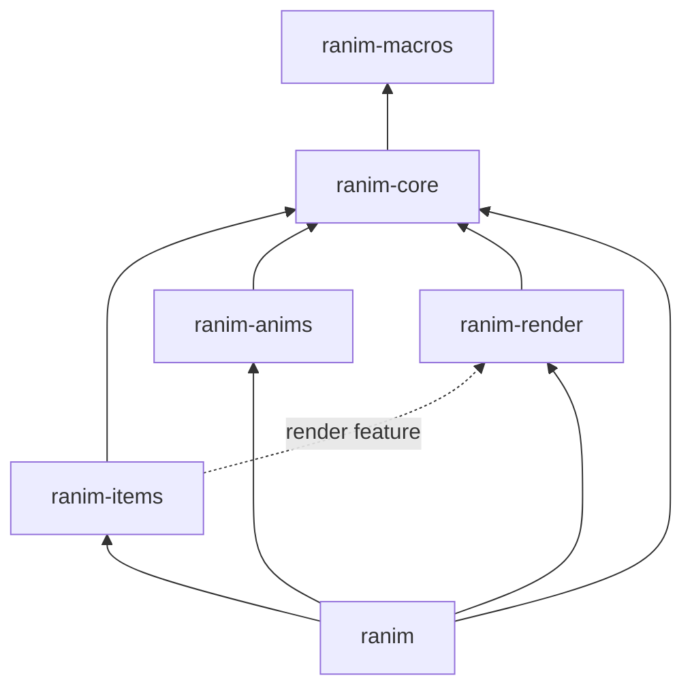

# Packages

```text
.
├── src/                        # ranim - 顶层 facade crate（含 App/Plugin 项目装配与命令行入口）
├── packages/
│   ├── ranim-core/             # 核心动画引擎（求值、组合、通用变换与动画 trait）
│   ├── ranim-macros/           # proc-macro（#[scene]、#[output] 等）
│   ├── ranim-items/            # 内置物件、相机与可选的物件渲染插件
│   ├── ranim-anims/            # 内置动画（淡入淡出、变形、书写等）
│   ├── ranim-render/           # 通用渲染宿主与调度（wgpu / Bevy SubApp）
│   └── ranim-examples/         # 示例插件库与独立的预览宿主二进制
├── example-packages/app/       # 示例应用
├── benches/                    # 性能基准测试
└── xtasks/xtask-examples/      # 示例构建自动化
```



顶层 `ranim` 是 facade crate：`ranim::app` 模块是不依赖 GPU 的项目装配层，
`App` 保存场景目录与项目资源，`Plugin` 通过 `build(&self, app)` 扩展项目，
`SceneHandle` 持有场景所属 App；这些类型同时从 crate 根再导出。`ranim::cmd`
提供命令行入口与渲染、预览 API。项目二进制在 `main` 中创建 App、注册场景并
调用 `App::run()`；WASM 预览由宿主二进制启动，需要 JavaScript API 时也由
宿主自行导出。

`ranim-examples` 的库组合各例子的插件，`ranim-examples-preview` 二进制创建
App、安装组合插件，并导出网站和 rustdoc 使用的 `preview_scene(name)`。

`ranim-core` 将完整的 `Eval::Output` 写入类型化 `EvaluatedFrame`，保留容器、
层级与变换 wrapper，不依赖 renderer。`ranim-render` 持有独立的 Bevy `SubApp`，
提供提取与渲染 schedule，以及值级的 `extract::Extract` 协议。公共阶段由
renderer 创建的 `RenderSchedules` resource 提供 handles，渲染插件直接使用这些值；
仅插件内部使用的自定义 label / set 仍可正常定义。
`ranim-items` 通过可选的 `render` feature 实现内置物件的提取，顶层 `ranim`
的 `render` feature 会启用它。`ExtractPlugin<T>` 为帧实际保存的完整类型注册
提取系统。`ranim_items::camera::CameraFramePlugin`、`vitem::VItemPlugin` 与
`mesh::MeshItemPlugin` 各自注册裸逻辑类型的提取和相机/矢量/网格渲染能力，
render world 组件、GPU 缓冲与管线归对应的 items 模块。矢量插件同时注册
`Vec<VItem>`、几何、SVG、文字等输入，网格插件同时注册 `Surface` / `Sphere`；
三个插件覆盖裸内置类型，并由 `ranim_items::RanimItemsPlugin` 捆绑为一。

这组 `bevy_app::Plugin` 与项目层 `ranim::Plugin` 分别作用于不同的 App。
项目可以把 `ranim_render::RenderSetup` 存为 App resource，回调中安装
`RanimItemsPlugin` 与额外完整类型的 `ExtractPlugin<T>`；`RanimItemsPlugin`
与三个单件插件互斥（Bevy 插件唯一，重复安装会 panic）。项目未注册 setup 时，
preview、output 回退到默认配置（仅安装 `RanimItemsPlugin`）；setup 在每次创建
renderer 时重放。`Transformed<T, G>` 等未被内置插件覆盖的完整输出需在该
setup 中注册精确类型。项目装配层无需依赖 renderer，纯 CPU 场景查询和求值也
不会执行 GPU 装配。详见[完整求值帧与渲染提取](./understand/core/extract.md)。
