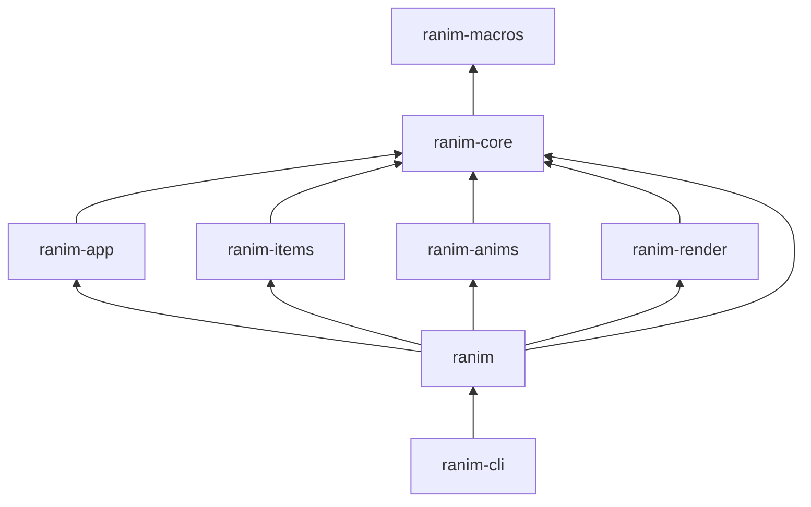

# Packages

```text
.
├── src/                        # ranim - 顶层 facade crate
├── packages/
│   ├── ranim-app/              # App、Plugin、动态插件加载、场景描述与项目资源
│   ├── ranim-core/             # 核心动画引擎（求值、组合、组件与动画 trait）
│   ├── ranim-macros/           # proc-macro（#[scene]、#[output]、#[export_plugin] 等）
│   ├── ranim-items/            # 内置可视元素（VItem、几何图形、SVG、文本）
│   ├── ranim-anims/            # 内置动画（淡入淡出、变形、书写等）
│   ├── ranim-render/           # GPU 渲染层（wgpu）
│   ├── ranim-cli/              # CLI 工具（渲染、预览、热加载）
│   └── ranim-examples/         # 示例插件库与独立的预览宿主二进制
├── example-packages/app/       # 示例应用
├── benches/                    # 性能基准测试
└── xtasks/xtask-examples/      # 示例构建自动化
```



`ranim-app` 是不依赖 GPU 的项目装配层：`App` 保存场景目录与项目资源，`Plugin`
通过 `build(&self, app)` 扩展项目，`SceneHandle` 持有场景所属 App。
顶层 `ranim` 再导出这些类型，并提供 `#[export_plugin]` 和 `cmd` 中的渲染、预览入口。
同一个插件可以直接通过 Rust 安装，也可以通过启用 `dylib` 的 `DynamicPlugin` 加载。
CLI、原生预览与 WASM 预览各自创建 App，再安装项目导出的插件；App 归宿主管理。
`#[export_plugin]` 保留 Rust 工厂函数，并生成唯一的原生动态库入口。WASM 预览由宿主二进制启动，
需要 JavaScript API 时也由宿主自行导出。

`ranim-examples` 的库组合各例子的插件，`ranim-examples-preview` 二进制创建
App、安装组合插件，并导出网站和 rustdoc 使用的 `preview_scene(name)`。

目前 `CoreItem` 及其内置渲染分支仍在既有 crate 中；App 层为后续抽离它们提供装配边界。
